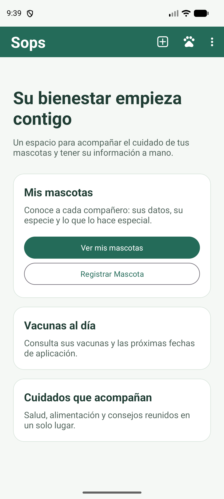
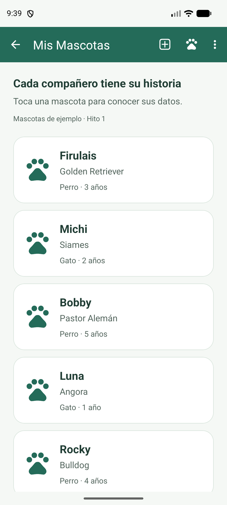
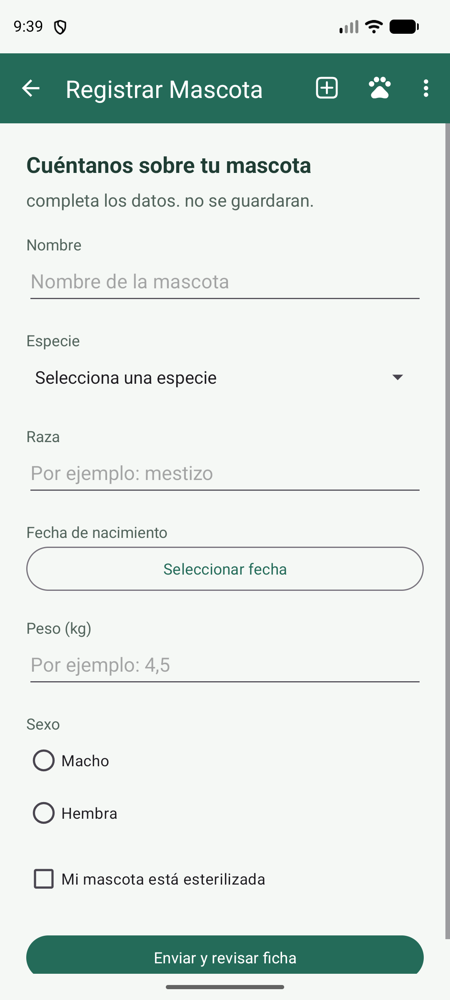
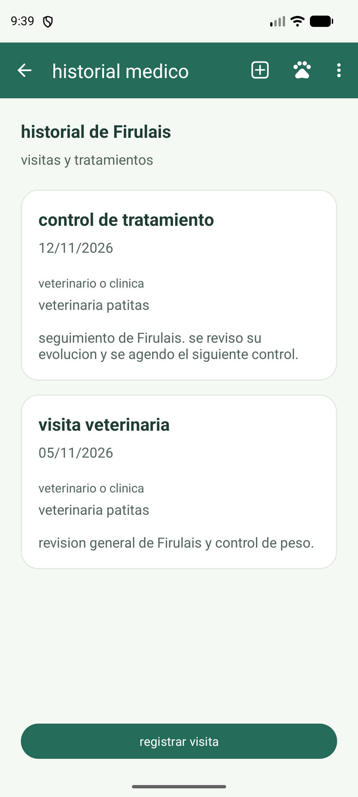
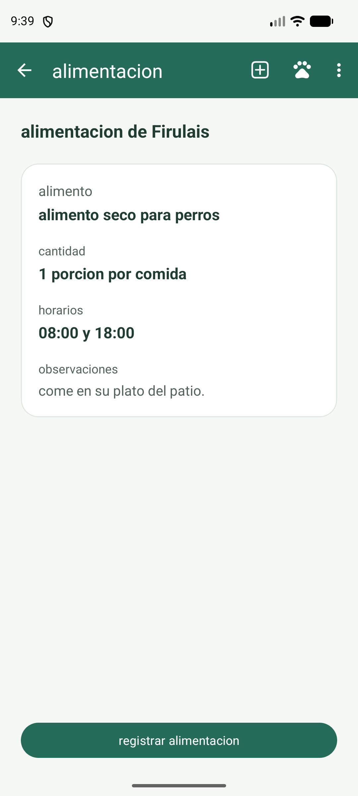
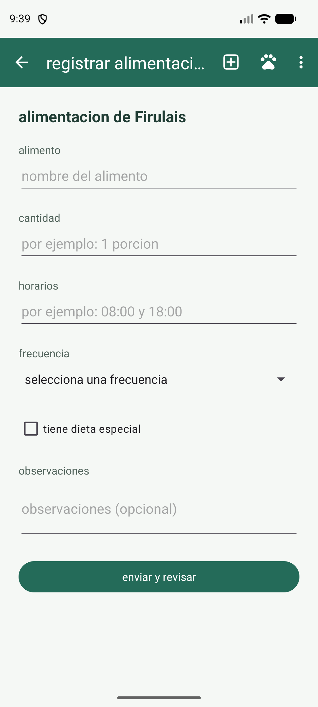
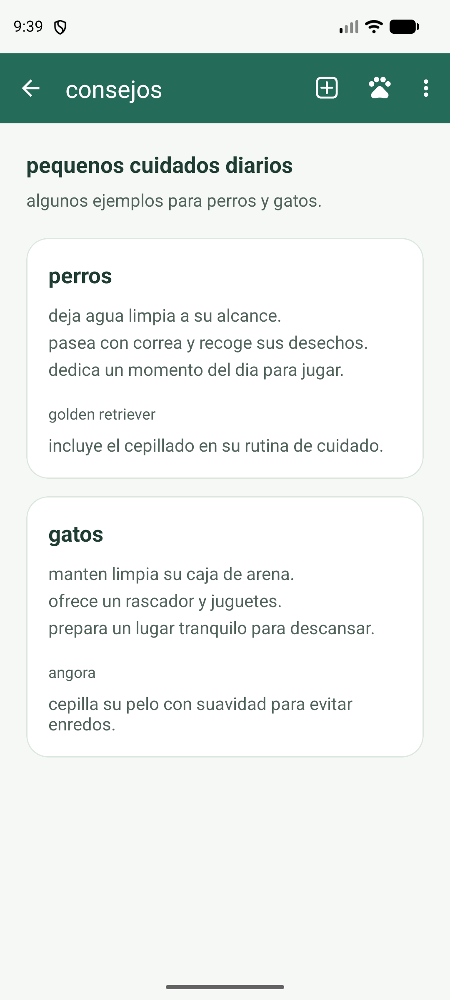
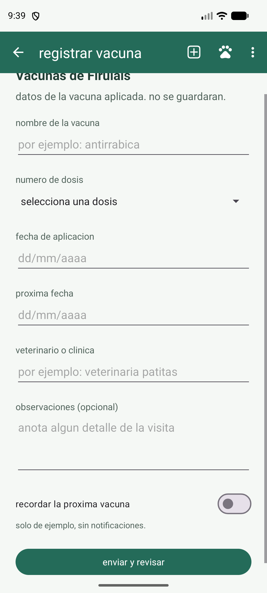
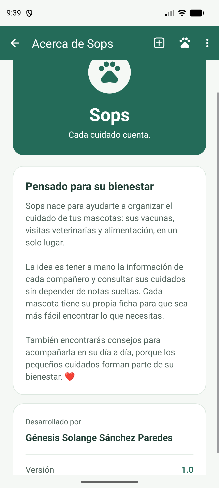

# Sops 🐾

Sops es una aplicación para organizar el cuidado de las mascotas. Reúne sus datos, vacunas, visitas veterinarias y alimentación en un solo lugar.

Este proyecto fue desarrollado por **Génesis Solange Sánchez Paredes**, para el curso **Desarrollo de Aplicaciones Móviles**, a cargo del docente **Ing. Omar Sulca Correa**, en la Universidad de Huánuco.

Este repositorio reúne el proyecto, las capturas de sus pantallas y la bitácora del desarrollo.

## Funciones desarrolladas

- Ver la lista de mascotas y abrir la ficha de cada una.
- Registrar y guardar una mascota en el celular.
- Consultar sus vacunas y llenar el formulario de una nueva vacuna.
- Revisar el historial médico y completar los datos de una visita.
- Consultar y registrar los datos de alimentación.
- Leer consejos de cuidado para perros y gatos.

## Funcionamiento

Desde **Inicio → Ver mis mascotas** se puede seleccionar una mascota y consultar su ficha. Allí se encuentran los accesos a vacunas, historial médico y alimentación. Cada sección cuenta con un botón para abrir su formulario.

La huella de la barra abre la lista de mascotas y el signo **+** abre su registro. En los tres puntos están Inicio, Consejos y Acerca de Sops. La flecha y el botón Atrás permiten regresar a la pantalla anterior.

Los formularios indican si falta completar un campo obligatorio. Al enviar los datos, se muestra una ficha o un resumen de lo ingresado.

## Estado del proyecto

El registro de mascotas ya guarda los datos en el celular y abre su ficha. La lista todavía muestra las mascotas de ejemplo. Los otros formularios aún no guardan datos y los recordatorios no envían avisos.

## Cómo abrir el proyecto

Se desarrolló con **Android Studio Quail 3 | 2026.1.3**.

1. Descargar el proyecto y abrir su carpeta en Android Studio.
2. Esperar a que termine de cargar e instalar los componentes que solicite.
3. Seleccionar un emulador o conectar un celular con Android 7.0 o una versión posterior.
4. Pulsar el botón **▶** para ejecutar la aplicación.

## Avances del proyecto

La [bitácora](BITACORA.md) reúne los avances y las dificultades encontradas durante el desarrollo. Las [capturas](evidencias/capturas/) muestran las pantallas de la aplicación.

## Pantallas

Capturas de Sops en funcionamiento.

| Inicio | Mis mascotas | Ficha de mascota |
| --- | --- | --- |
|  |  |  |

| Registrar mascota | Vacunas | Registrar vacuna |
| --- | --- | --- |
|  |  |  |

| Historial médico | Registrar visita | Alimentación |
| --- | --- | --- |
|  |  |  |

| Registrar alimentación | Consejos | Acerca de Sops |
| --- | --- | --- |
|  |  |  |

### Menú

### Continuación de las pantallas

| Registro de mascota | Registro de vacuna | Acerca de Sops |
| --- | --- | --- |
|  |  |  |
