# Sops 🐾

Sops es una aplicación para organizar el cuidado de las mascotas. Reúne sus datos, vacunas, visitas veterinarias y alimentación en un solo lugar.

Este proyecto fue desarrollado por **Génesis Solange Sánchez Paredes**, para el curso **Desarrollo de Aplicaciones Móviles**, a cargo del docente **Ing. Omar Sulca Correa**, en la Universidad de Huánuco.

Este repositorio reúne el proyecto, las capturas de sus pantallas y la bitácora del desarrollo.

## Funciones desarrolladas

- Ver la lista de mascotas y abrir la ficha de cada una.
- Registrar y guardar una mascota en el celular.
- Editar sus datos o eliminar su ficha con confirmación.
- Guardar vacunas y consultar las que pertenecen a cada mascota.
- Abrir el detalle de una vacuna para ver sus fechas, veterinario y observaciones.
- Editar los datos de una vacuna guardada.
- Eliminar una vacuna con confirmación.
- Guardar visitas veterinarias y consultarlas en el historial de cada mascota.
- Tocar una visita del historial para abrir su detalle.
- Editar una visita guardada desde su detalle.
- Consultar y registrar los datos de alimentación.
- Leer consejos de cuidado para perros y gatos.

## Funcionamiento

Desde **Inicio → Ver mis mascotas** se puede seleccionar una mascota y consultar su ficha. Allí se encuentran los accesos a vacunas, historial médico y alimentación. Cada sección cuenta con un botón para abrir su formulario.

En la ficha de una mascota guardada, **editar mascota** abre el formulario con sus datos. **Eliminar mascota** pide confirmar antes de borrar el registro y regresar a la lista.

La huella de la barra abre la lista de mascotas y el signo **+** abre su registro. En los tres puntos están Inicio, Consejos y Acerca de Sops. La flecha y el botón Atrás permiten regresar a la pantalla anterior.

En la lista de vacunas, al tocar una tarjeta se abre su detalle con los datos guardados y la mascota a la que pertenece. El botón **editar vacuna** abre el formulario con sus datos actuales; al guardar los cambios, el detalle y la lista se actualizan.

En ese mismo detalle, **eliminar vacuna** permite borrar el registro después de confirmar. Al cancelar, la vacuna se conserva; al eliminarla, se regresa a la lista actualizada.

Los formularios indican si falta completar un campo obligatorio. Al guardar una mascota se abre su ficha; al guardar una vacuna se regresa a su lista. Al guardar una visita se regresa al historial actualizado de la mascota. El formulario de alimentación todavía muestra un resumen.

Al tocar una visita del historial se abre su detalle, con el diagnóstico, tratamiento, veterinario y próxima revisión. Los campos que no tienen datos muestran «sin registrar». El botón **editar visita** abre el formulario con los datos actuales y guarda los cambios en la misma visita.

## Estado del proyecto

El registro de mascotas ya guarda los datos en el celular y abre su ficha. Mis mascotas muestra los registros guardados y se actualiza al volver a la pantalla. También permite editar y eliminar mascotas. Las vacunas se guardan vinculadas a la mascota seleccionada y aparecen en su lista. Las visitas también se guardan por mascota y se muestran en su historial. Alimentación aún no guarda datos; los recordatorios no envían avisos.

## Antes y ahora

### Primera versión

Se crearon las pantallas, el menú y los formularios. La lista mostraba cinco mascotas de ejemplo y permitía abrir sus fichas. Al completar un formulario se mostraba un resumen, pero los datos no se guardaban.

### Avances con Room

Primero se preparó la base de datos de mascotas. Después se conectó el formulario para guardar los registros y abrir su ficha. Luego se conectó Mis mascotas para consultar los datos guardados. El siguiente avance agregó la edición y eliminación desde la ficha.

| Parte de la app | Antes | Ahora |
| --- | --- | --- |
| Registro de mascotas | Mostraba una ficha sin guardar los datos. | Guarda la mascota en el celular y abre su ficha. |
| Mis mascotas | Mostraba las cinco mascotas de ejemplo. | Muestra las mascotas guardadas y se actualiza al regresar. |
| Editar mascota | No había una opción para cambiar sus datos. | Abre el formulario con los datos actuales y guarda los cambios en el mismo registro. |
| Eliminar mascota | No se podían borrar mascotas desde la ficha. | Pide confirmación, elimina el registro y actualiza la lista. |
| Al cerrar la app | Los datos ingresados se perdían. | Las mascotas registradas permanecen guardadas. |
| Vacunas | Mostraba registros de ejemplo y el formulario solo mostraba un resumen. | Guarda las vacunas de la mascota seleccionada y actualiza su lista. |
| Detalle de vacuna | Solo se podían ver los datos resumidos de la tarjeta. | Al tocarla se abre una pantalla con sus datos completos. |
| Editar vacuna | No se podían cambiar los datos de una vacuna guardada. | El formulario carga sus datos y actualiza el mismo registro. |
| Eliminar vacuna | No había una opción para borrar una vacuna. | Pide confirmación y elimina solo la vacuna seleccionada. |
| Visitas veterinarias | El formulario mostraba un resumen sin guardar. | Guarda la visita y actualiza el historial de la mascota. |
| Detalle de visita | Los datos se consultaban en la tarjeta del historial. | Al tocar la tarjeta se abre una pantalla con todos sus datos guardados. |
| Editar visita | No se podían modificar las visitas guardadas. | Carga los datos en el formulario y actualiza la misma visita. |
| Alimentación | El formulario mostraba un resumen. | Mantiene ese funcionamiento; falta conectar su guardado. |

Esta sección se irá ampliando con los siguientes avances.

En vacunas primero se prepararon la entidad, su DAO y la tabla en la base de datos. Después se agregó la relación con las mascotas y se conectaron el formulario y la lista. Cada mascota muestra sus propias vacunas. Al eliminar una mascota también se eliminan sus vacunas, previa confirmación.

El siguiente avance agregó la pantalla de detalle para consultar toda la información de una vacuna desde su tarjeta.

Después se agregó la edición de vacunas, reutilizando el formulario y conservando la mascota a la que pertenece cada registro.

Más adelante se añadió la eliminación con confirmación desde el detalle, actualizando la lista de la mascota al terminar.

## Cómo abrir el proyecto

Se desarrolló con **Android Studio Quail 3 | 2026.1.3**.

1. Descargar el proyecto y abrir su carpeta en Android Studio.
2. Esperar a que termine de cargar e instalar los componentes que solicite.
3. Seleccionar un emulador o conectar un celular con Android 7.0 o una versión posterior.
4. Pulsar el botón **▶** para ejecutar la aplicación.

## Avances del proyecto

La [bitácora](BITACORA.md) reúne los avances y las dificultades encontradas durante el desarrollo. Las [capturas](evidencias/capturas/) muestran las pantallas de la aplicación.

## Pantallas

Estas capturas corresponden a la primera versión de Sops. Se conservan para mostrar cómo empezó el proyecto; las capturas de los nuevos avances se agregarán por separado.

### Primera versión

| Inicio | Mis mascotas | Ficha de mascota |
| --- | --- | --- |
|  |  | 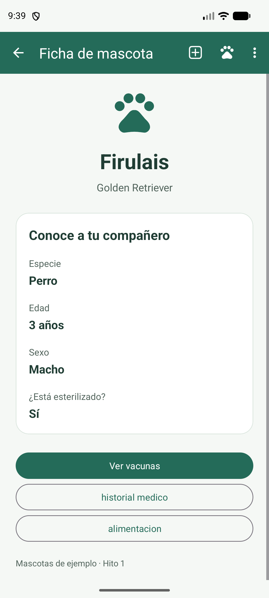 |

| Registrar mascota | Vacunas | Registrar vacuna |
| --- | --- | --- |
|  | 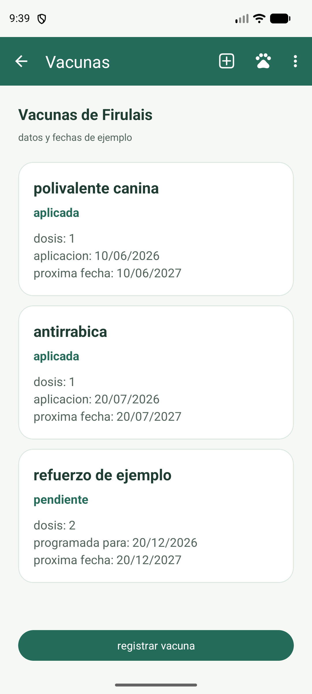 | 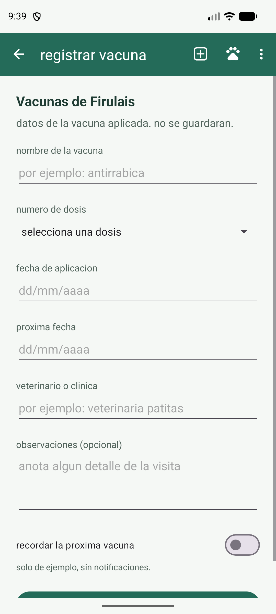 |

| Historial médico | Registrar visita | Alimentación |
| --- | --- | --- |
|  | 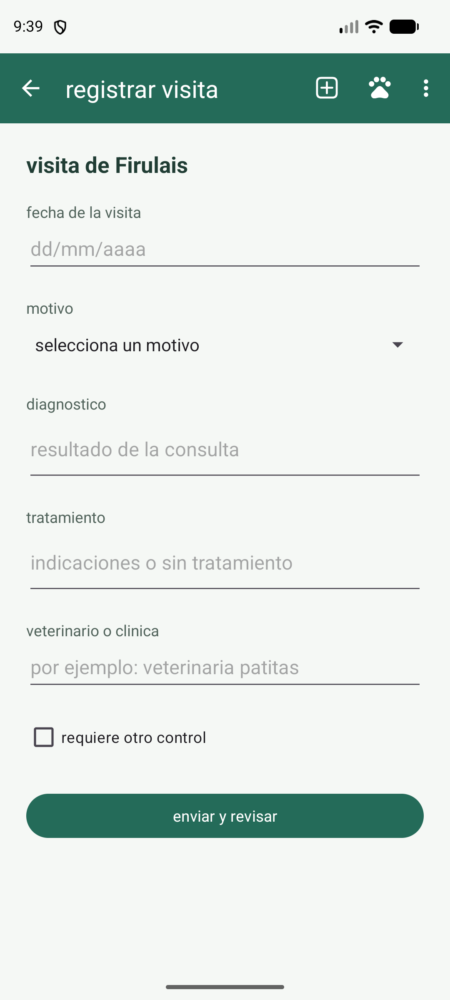 |  |

| Registrar alimentación | Consejos | Acerca de Sops |
| --- | --- | --- |
|  |  | 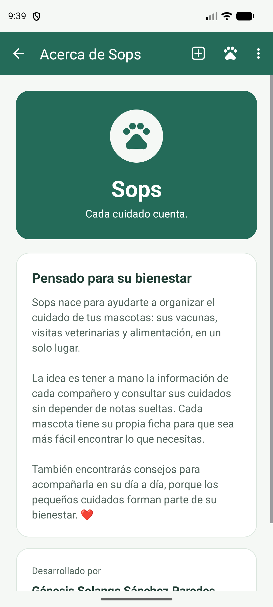 |

### Menú

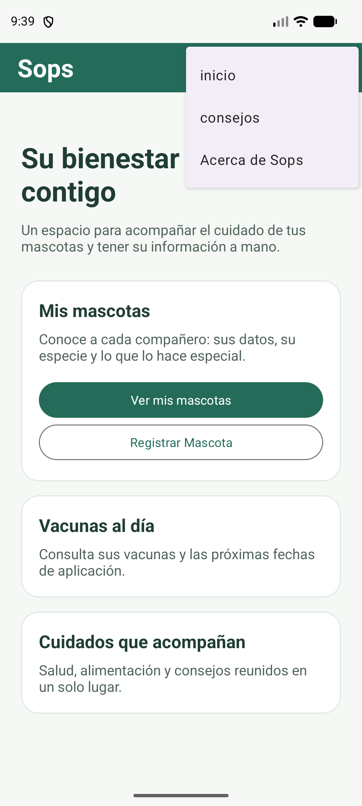

### Continuación de las pantallas

| Registro de mascota | Registro de vacuna | Acerca de Sops |
| --- | --- | --- |
| 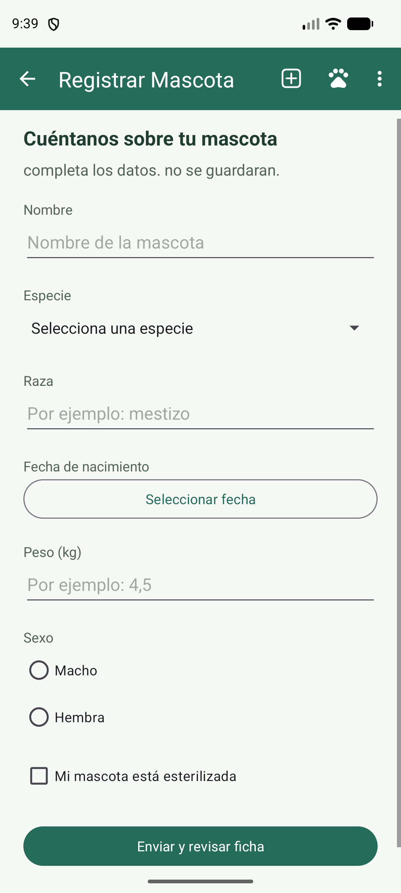 |  |  |

### Hito 2: mascotas y vacunas guardadas

Estas capturas muestran el registro, la consulta, la edición y la eliminación de mascotas y vacunas. Los formularios contienen los datos ingresados durante el recorrido.

| Registrar mascota | Ficha guardada | Editar mascota |
| --- | --- | --- |
| 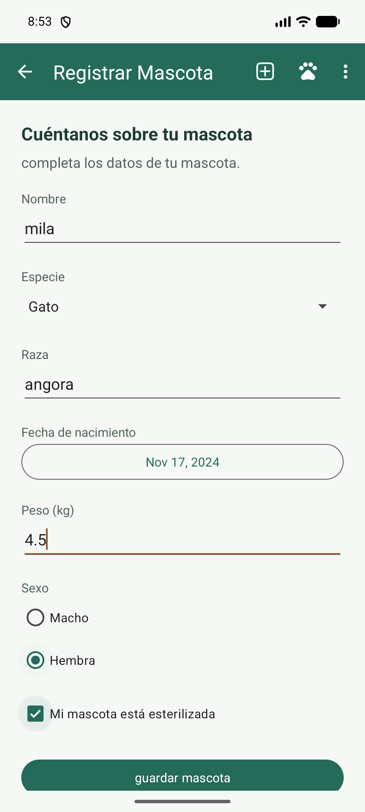 | 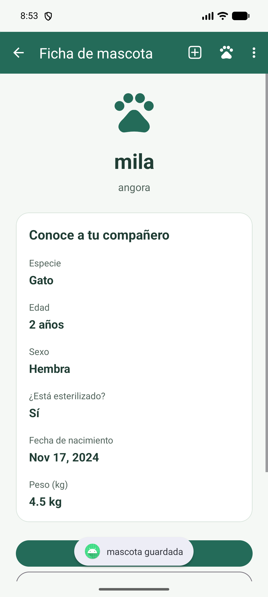 | 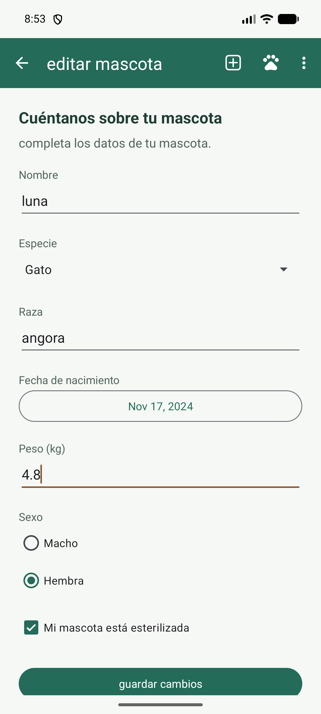 |

| Registrar vacuna | Vacunas de la mascota | Detalle de vacuna |
| --- | --- | --- |
| 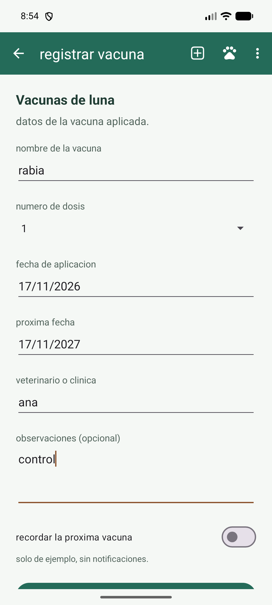 | 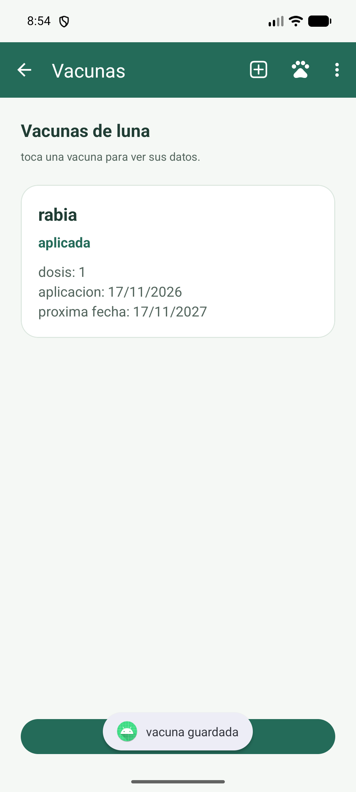 | 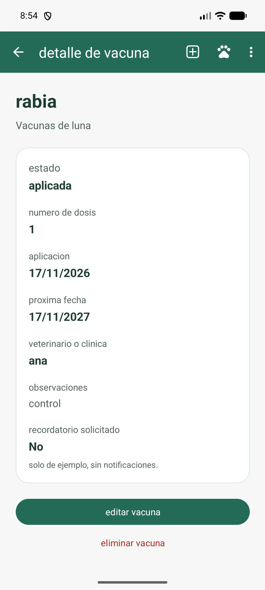 |

| Editar vacuna | Vacuna actualizada | Confirmar eliminación |
| --- | --- | --- |
| 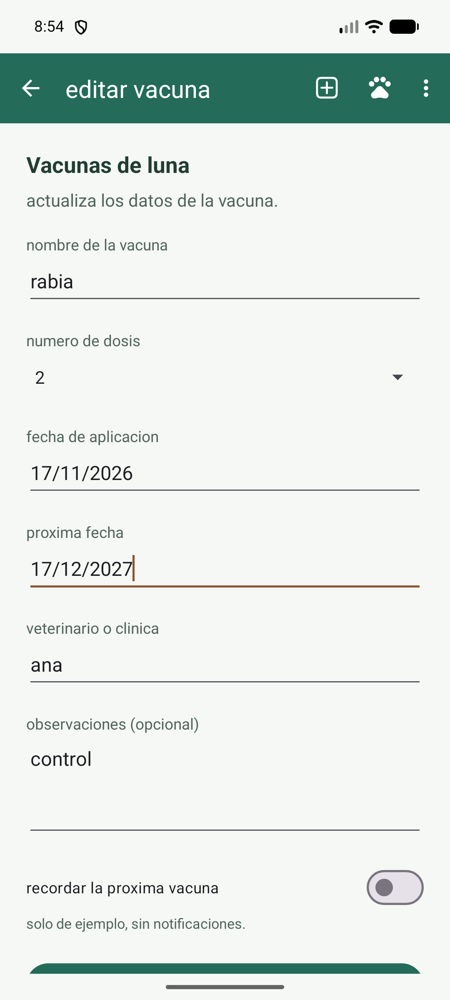 | 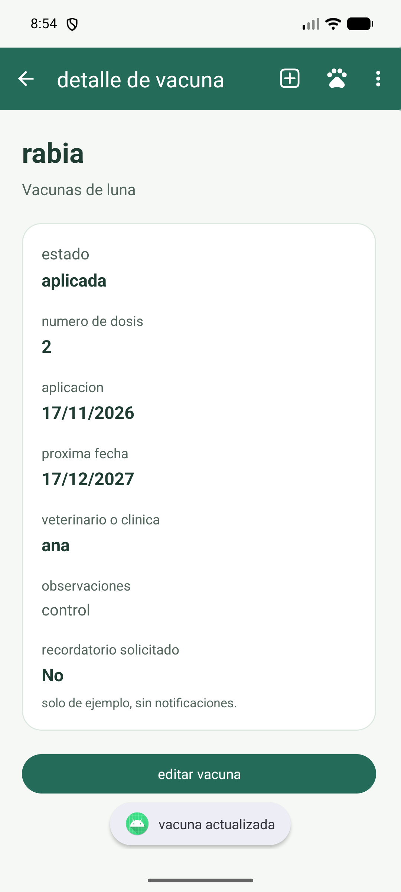 | 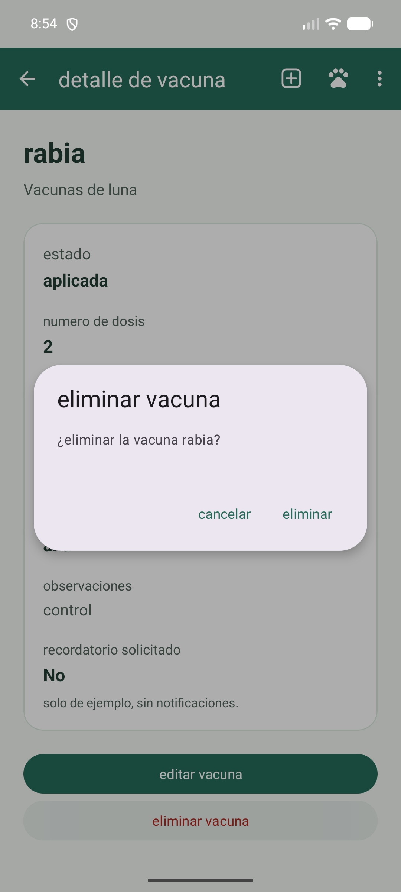 |

| Lista después de eliminar | Eliminar mascota | Consejos |
| --- | --- | --- |
| 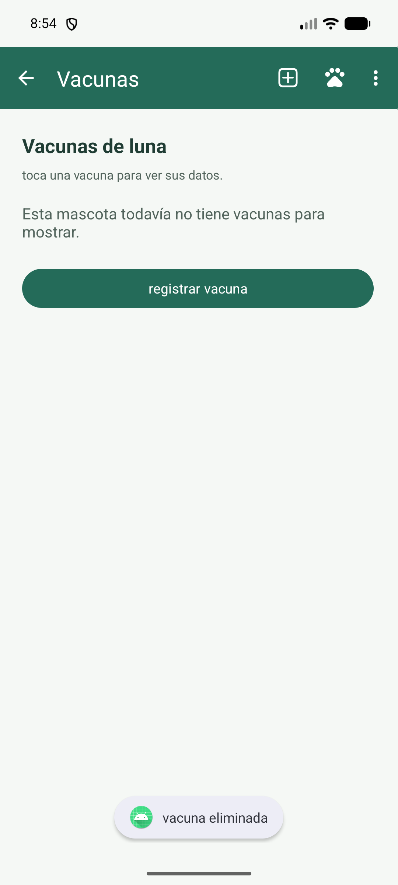 | 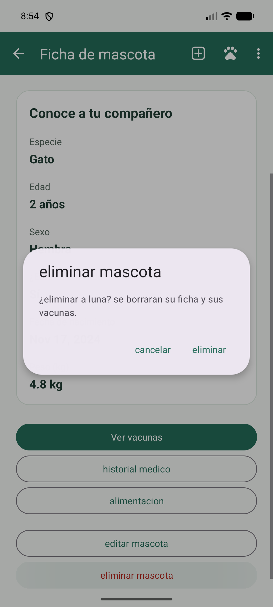 |  |

El resto de las imágenes está en la [carpeta de capturas del Hito 2](evidencias/capturas/hito2/). El video del recorrido incluye la escritura de los formularios y una breve explicación en pantalla de la organización del código. Se adjunta por separado en Classroom.
